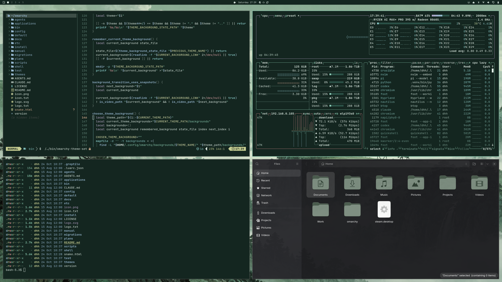
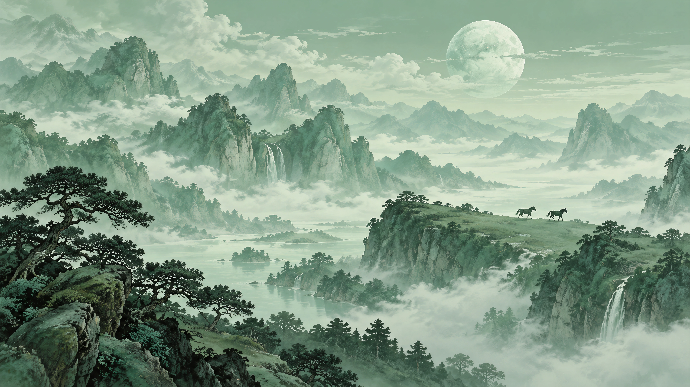
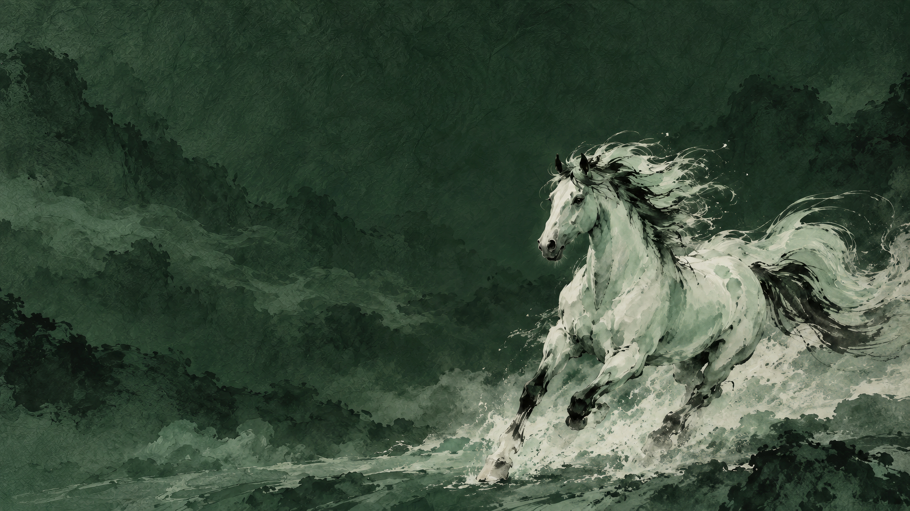
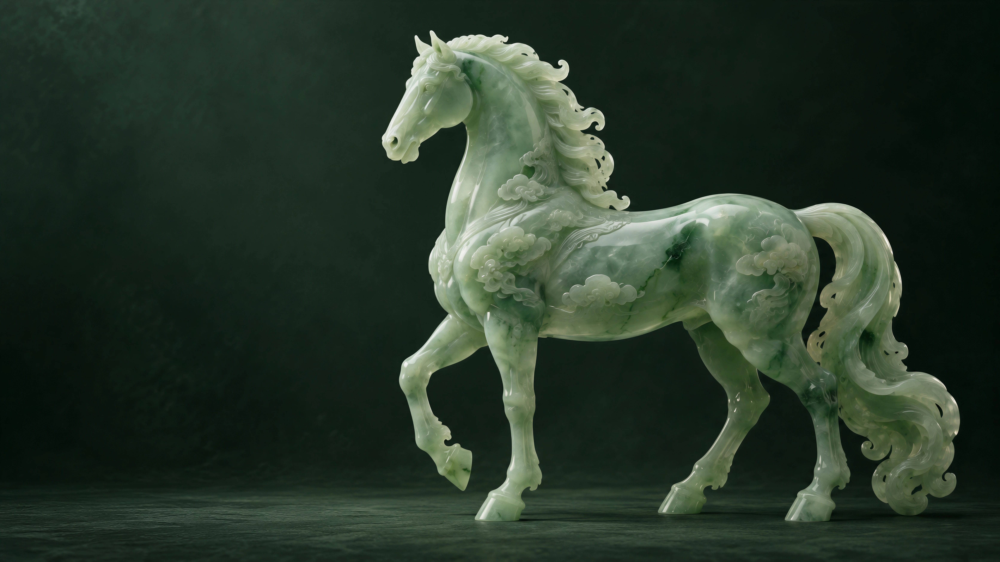

# Jade Horse for Omarchy

A cool jade edition of the Chinese Year of the Horse theme: deep pine surfaces, celadon accents, pale green-white text, and sage folder icons.



## Install

```sh
omarchy theme install https://github.com/dhh/omarchy-jade-horse-theme
```

## Backgrounds

Six original wallpapers are included. Cycle through them with `omarchy theme bg next`.

### Mountain Horses



### Ink Horse



### Carved Jade Horse



Wallpapers were generated with OpenAI image generation and upscaled 4× from 1672 × 941 to 6688 × 3764. The [generation prompts](PROMPTS.md) are included.

## Palette

| Role | Color |
| --- | --- |
| Background | `#142620` |
| Foreground | `#dfede5` |
| Jade accent | `#8bcbb1` |
| Selection | `#2b5147` |

Omarchy generates application themes from `colors.toml`.

For a red and gold version, see [Year of the Horse](https://github.com/dhh/omarchy-year-of-the-horse-theme).

## License

MIT
